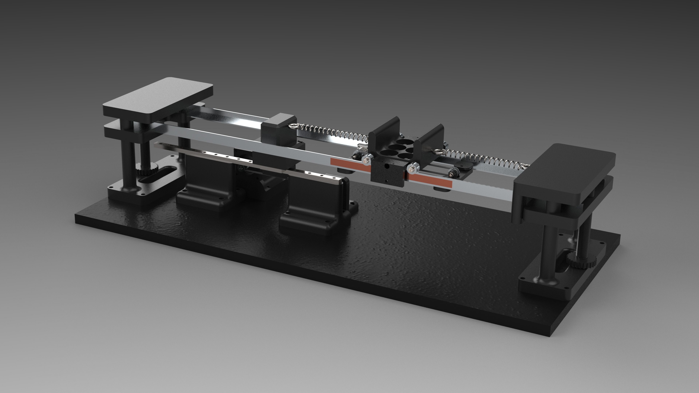

<h1 align="center">OMTP: Oscillatory Motion Test Platform</h1>

<p align="center">
  
</p>

<p align="center">
  <b>An open-source, single-axis spring–mass–damper rig that turns textbook vibration curves into real measured data.</b><br>
  Stepper-driven base excitation · drift-free magnetic encoder · adjustable eddy-current damping · CAD, BOM, firmware and UI included
</p>

---

## Why this exists

Free response, step response and frequency response are taught everywhere, but almost always as equations and simulated plots. Very little footage exists of a physical machine producing those curves in real time. OMTP is built to close that gap: a cart oscillates between two springs, a stepper motor drives it with precise inputs, and a contactless encoder records its motion, so the exponential decay, the overshoot and the resonance peak appear live on screen, from real hardware.

The design is fully open so that students, instructors and hobbyists can build one, reproduce the results and extend it.

## What it can do

| Test | Friction only (magnets removed) | Friction + eddy-current damping |
|---|---|---|
| **Free response** | Linear-envelope decay; friction estimate | Exponential decay; ζ, ω<sub>d</sub>, ω<sub>n</sub>, k by logarithmic decrement |
| **Step response** | Lightly damped ringing about a new equilibrium | Percent overshoot, peak time, ζ, ω<sub>n</sub>, and k₁/k₂ from the static gain |
| **Frequency response** | Sharp resonance peak | Bode magnitude and phase versus the model, at several damping levels |

It also supports:

- **Ideal-response playback:** with the cart detached, the motorized wall plays computed ideal curves (scaled to the motor's limits) to show next to the real system.
- **Parameter sweeps:** spring rate, cart mass, damping level and input amplitude.
- **Transient phenomena:** resonance build-up, beating, and chirp or broadband excitation.
- **Arbitrary inputs:** any wall trajectory within the motor's speed, torque and travel limits.

## How it works

```
NEMA 23 ─► GT2 belt ─► moving wall ─► spring k₁ ─► cart (m) ─► spring k₂ ─► fixed wall
                                                     │
                                       eddy-current damping c to ground
```

- **Base excitation.** The stepper positions the *end of a spring*, never the cart itself, so the cart responds freely through the springs. The stepper's stiffness becomes an advantage: a precise, repeatable displacement input x<sub>in</sub>(t).
- **Oscillator.** The cart rides on four 20T idler wheels running on the 0.085 in edge of two aluminum angle rails. The flanges straddle the edge for lateral guidance. Pre-tensioned extension springs connect the cart to the moving wall and to the fixed wall. The track height is adjustable so the springs can carry a small share of the cart's weight, reducing wheel friction.
- **Damping.** C110 copper bars on the outer rail faces, with N52 magnets on the cart, produce velocity-proportional eddy-current drag. It's contactless, has no seals and no stiction, and is linear well beyond the rig's speeds. Damping is set by the magnet configuration (off, 1 + 1, or 2 + 2 stacked) and fine-tuned by the gap.
- **Sensing.** An idler-only GT2 belt loop clamped to the cart turns an AS5600 12-bit magnetic encoder, giving about 0.011 mm resolution with no drift and no contact with the cart.

The governing model is a classical second-order system. Damping acts relative to ground, so the transfer function has no zero:

```
m·ẍ + c·ẋ + F_c·sgn(ẋ) + (k₁ + k₂)·x = k₁·x_in(t)

X/X_in = k₁ / (m·s² + c·s + k₁ + k₂)        ω_n = √((k₁ + k₂)/m)        ζ = c / (2√((k₁ + k₂)·m))
```

## Key specifications

| | |
|---|---|
| Cart travel | ±75 mm operating, about ±80 mm mechanical limit |
| Drive | NEMA 23 (3 N·m), TB6600 driver, 20T GT2 pulley (40 mm/rev) |
| Peak wall speed | about 0.45 m/s (calibrated limit set in firmware) |
| Position sensor | AS5600 on an idler belt loop (12.20 mm idlers, about 44.6 mm/rev) |
| Resolution / sample rate | about 0.011 mm / 1 kHz |
| Damping | Eddy current: copper + aluminum rails, N52 40 × 10 × 5 mm magnets |
| Controller | ESP32 (Arduino IDE), USB serial to a Python UI |
| Power | 36 V 5 A supply, LM2596 buck to 5 V |

## Repository structure

```
├── OMTP V1/
│   ├── CAD/                          SolidWorks parts and assemblies
│   │   ├── 00_Reference/             Vendor and off-the-shelf models (NEMA 23, pulleys, idlers, MGN12 rail, angle, spring)
│   │   ├── 10_Frame/                 Wooden base, base mounts, leveling screws and shelves, motor mount, top covers
│   │   ├── 20_Drive/                 Drive belt, belt clamp, idler bushing, pulley tower, moving wall and its cart
│   │   ├── 30_Track/                 (empty)
│   │   ├── 40_Cart/                  Mass cart body, offset plate, wheel bushings, spring hooks, belt clamp
│   │   ├── 50_Sensor/                AS5600 encoder mount, sensor belt loop and clamps
│   │   ├── 60_Damper/                Copper damping plate, magnets and magnet holder
│   │   ├── 70_Electronics/           Electrical box assembly, and wire management strap
│   │   ├── 80_Drawings/              (empty)
│   │   ├── 90_Exports/               Generated STL, STEP and DXF files
│   │   ├── 99_Archive/               Superseded revisions
│   │   ├── 100_Main_Assembly/        Master_Assembly.SLDASM (top-level assembly)
│   │   └── FORMAT/                   Planned folder and part-numbering scheme
│   ├── Electrical/                   Wiring diagram
│   ├── Firmware and code/            Software requirements (firmware and UI source to be added)
│   ├── Parts, and Bill of Materials/ Bill of materials and concept overview
│   └── _Archive_/                    Earlier concept and parts list
└── docs/                             Renders and images for this README
```

## Getting started

<<<<<<< HEAD
1. **Open the CAD.** The top-level assembly is [`Master_Assembly.SLDASM`](OMTP%20V1/CAD/100_Main_Assembly/Master_Assembly.SLDASM), and each subsystem has its own folder under [`OMTP V1/CAD/`](OMTP%20V1/CAD/).
2. **Build the hardware.** Order the parts in the [bill of materials](OMTP%20V1/Parts,%20and%20Bill%20of%20Materials/OSCAR_V3_BOM.pdf) and print the parts from [`90_Exports/STL/`](OMTP%20V1/CAD/90_Exports/STL/). Wire the electronics following the [wiring diagram](OMTP%20V1/Electrical/WiringDiagram_V2.drawio.pdf).
3. **Flash the firmware** *(not yet published)*. The firmware will be an Arduino IDE sketch for the ESP32, with a configuration block at the top for microstepping, travel limit and mm-per-rev constants.
4. **Run the UI** *(not yet published)*. The Python UI will connect to the ESP32's serial port, with free response as the first mode.
5. **Calibrate.** Follow Section 7 of the [software requirements](OMTP%20V1/Firmware%20and%20code/OMTP_Software_Requirements%20updated.pdf): motor and sensor travel per revolution, speed and acceleration limits, and phase delay.

## Documentation

- **[Concept Overview (Rev. 3)](OMTP%20V1/Parts,%20and%20Bill%20of%20Materials/Oscillation_Rig_Concept_3.pdf):** architecture, subsystems, model and design constraints.
- **[Software Requirements (Rev. 1.1)](OMTP%20V1/Firmware%20and%20code/OMTP_Software_Requirements%20updated.pdf)** ([.docx](OMTP%20V1/Firmware%20and%20code/OMTP_Software_Requirements%20updated.docx)): firmware and UI requirements, analysis methods and calibration.
- **[Wiring diagram](OMTP%20V1/Electrical/WiringDiagram_V2.drawio.pdf):** ESP32, TB6600, stepper, AS5600 and power connections.
- **[Bill of materials](OMTP%20V1/Parts,%20and%20Bill%20of%20Materials/OSCAR_V3_BOM.pdf)** ([.docx](OMTP%20V1/Parts,%20and%20Bill%20of%20Materials/OSCAR_V3_BOM.docx)): parts, suppliers and prices (CAD).
=======
1. **Build the hardware.** Order and print the parts in [`BOM/`](BOM/). The STL files are in [`CAD/`](CAD/), and wiring follows the pinout diagram in [`OMTP V1/`](Electrical/).
2. **Flash the firmware.** Open the sketch in [`Code/firmware/`](Code/firmware/) with the Arduino IDE, install the listed libraries, and set the configuration block at the top of the sketch (microstepping, travel limit, mm-per-rev constants).
3. **Run the UI.** Install the Python requirements in [`Code/ui/`](Code/ui/), connect to the ESP32's serial port, and start in free response mode.
4. **Calibrate.** Follow the calibration section of the software requirements: motor and sensor travel per revolution, speed and acceleration limits, and phase delay.

## Documentation

- **Concept Overview (Rev. 3):** architecture, subsystems, model and design constraints.
- **Software Requirements (Rev. 1.1):** firmware and UI requirements, analysis methods and calibration.
- **Pinout diagram:** ESP32, TB6600 and AS5600 connections.
>>>>>>> e5d7fddacd94af89a83e0e73e44755c76084904c

## Project status

The mechanical design is complete. Build, firmware, UI and testing are in progress; measured results and video will be added as they come in.

- [x] Concept and architecture
- [x] Mechanical design (CAD)
- [ ] Build and assembly
- [ ] Firmware
- [ ] Python UI
- [ ] Calibration and validation against the model
- [ ] Demo video with live plots

## Safety

- **N52 magnets** pinch skin and shatter if they snap together. Slide them apart sideways, and keep them away from electronics, cards and pacemakers.
- **Moving parts:** keep hands clear of the belt drive and the cart during powered tests.
- **36 V supply:** wire and fuse it properly, and disconnect power before rewiring.

## Acknowledgements

Inspired by the OSCAR teaching rig used in a mechatronics modelling course at Simon Fraser University. OMTP is an independent design.

## License

See [`LICENSE`](LICENSE).

- **Hardware** (CAD, BOM, drawings): [CERN-OHL-P v2](https://ohwr.org/cern_ohl_p_v2.txt)
- **Software** (firmware, UI): [MIT](https://opensource.org/licenses/MIT)
- **Documentation and media:** [CC BY 4.0](https://creativecommons.org/licenses/by/4.0/)
